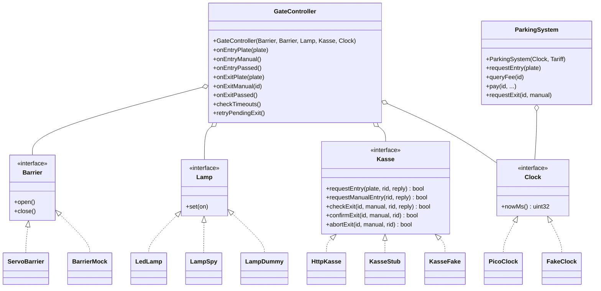

# Parksystem M450

Parkhaus mit Ein- und Ausfahrtsschranke, Kennzeichenerfassung,
Gebührenberechnung und Bezahlung – umgesetzt mit **2 × Raspberry Pi Pico W**
in **Arduino (C++17)** mit PlatformIO.

## Gruppenmitglieder

- Nataliia Kakhnych

## Kurze Beschreibung der Umsetzung

| | Pico 1 „Kasse" | Pico 2 „Schranken" |
|---|---|---|
| Rolle | Leitstelle: Fahrzeugregister, Gebühren, Zahlungen, Protokoll | Steuert beide Schranken, simuliert die Kamera |
| WLAN | spannt das WLAN `Parkhaus-M450` auf (Access Point) | verbindet sich mit diesem WLAN |
| Adresse | <http://192.168.42.1/> | <http://192.168.42.2/> |
| Weboberfläche | Kasse/Zahlautomat (Gebühr anzeigen, bezahlen), Belegung, Register, Protokoll | Kamera-Simulation: Kennzeichen an Ein-/Ausfahrt eingeben, manuelle Abfertigung, Durchfahrt bestätigen |
| Hardware | – | SG90-Servo als Schranke (GP8; optional zweiter Servo für die Ausfahrt an GP9), Onboard-LED (an = Schranke offen) |
| Code | `src/kasse/main.cpp` + Logik `ParkingSystem` | `src/schranken/main.cpp` + Logik `GateController` |

- **Entscheidungen trifft immer Pico 1.** Pico 2 meldet jedes erfasste
  Kennzeichen per HTTP an Pico 1 und öffnet die Schranke nur bei einer
  Freigabe. Ist Pico 1 nicht erreichbar, bleiben die Schranken zu
  (**Fail-safe**). Das Protokoll ist in
  [docs/HTTP-Protokoll.md](docs/HTTP-Protokoll.md) beschrieben.
- **Robust bei wackeligem WLAN:** Pico 2 wiederholt fehlgeschlagene Anfragen
  an die Kasse (bis zu 3 Versuche), die Weboberflächen ebenso. Jede Aktion
  trägt eine Request-ID; eine Wiederholung bekommt die gespeicherte Antwort,
  statt die Aktion doppelt auszuführen (keine doppelte Registrierung oder
  Zahlung). Jede Antwort schliesst die Verbindung sofort, weil der WebServer
  des Pico sonst bis zu 5 s auf den Browser wartet und andere Anfragen blockiert.
- **Rückmeldung in der Oberfläche:** Während einer Aktion sind die Buttons
  gesperrt und eine Ladeanzeige läuft. Beide Seiten aktualisieren sich
  automatisch (Kamera-Simulation jede Sekunde, Kasse alle 3 s) und zeigen
  den Verbindungsstatus; zusätzlich gibt es einen Button „Aktualisieren".
- **Logik ohne Hardware:** Die Logik beider Picos (Kennzeichenprüfung,
  Tarif, Register, Protokoll, Protokollformat, Schrankensteuerung) liegt in
  `lib/ParkCore/`. Schranke, LED, Kasse und Zeit bekommt sie über
  Schnittstellen übergeben (siehe
  [Automatisierte Tests mit Test Doubles](#automatisierte-tests-mit-test-doubles)).
- **Zentrale Konfiguration** in [`include/Config.h`](include/Config.h):
  Kapazität, Tarif (Zeiteinheit, Preis, Freigrenze, Tageshöchstsatz),
  Karenzzeit, Schranken-Timeout, Protokoll-Obergrenze, WLAN und Servo-Pins.
  `PARK_TEST_CONFIG 1` aktiviert die Testkonfiguration aus dem Testkonzept
  (3 Plätze, 1 Min. Zeiteinheit/Freigrenze, CHF 1.00 pro Minute,
  Höchstsatz CHF 5.00, Karenzzeit 2 Min., 10 Protokolleinträge);
  `0` die Produktivwerte.
- **Kein dynamischer Speicher in der eigenen Logik:** Register
  (`CAPACITY + 10` Einträge) und Protokoll (Ringpuffer) haben feste
  Obergrenzen; HTML wird stückweise aus einem festen Puffer gesendet.
- Geldbeträge werden ganzzahlig in Rappen gerechnet.

### Abweichung von den Anforderungen

Die Anforderungen sahen „keine Servos" vor und simulieren die Schranke nur mit
der Onboard-LED. Für die Umsetzung stand ein SG90-Servo zur Verfügung, darum
bewegt Pico 2 zusätzlich einen Servo als Schranke. Ein- und Ausfahrt bleiben
zwei logisch getrennte Schranken (eigener Status „Einfahrt offen/zu" bzw.
„Ausfahrt offen/zu", eigene Meldungen); der eine Servo ist ihre gemeinsame
physische Schranke. Die LED leuchtet weiterhin, solange eine Schranke offen
ist, sodass alle Testfälle unverändert gelten. Ohne Servo läuft das System
genauso.

## Aufbau / Verdrahtung (Pico 2)

**Standard: ein Servo** (`SERVO_COUNT = 1` in `include/Config.h`) – eine
gemeinsame Schranke für Ein- und Ausfahrt:

| SG90-Kabel | Pico 2 |
|---|---|
| orange (Signal) | GP8 (Pin 11) |
| rot (VCC) | VBUS (Pin 40) |
| braun (GND) | GND (z. B. Pin 38) |

Ist die Schranke gerade für die Einfahrt offen, wird eine Ausfahrt mit
„Schranke gerade für die Einfahrt … offen – bitte warten" abgewiesen (und
umgekehrt), bis die Durchfahrt bestätigt ist oder der 30-s-Timeout greift.

**Optional: zwei Servos** (`SERVO_COUNT = 2`) – getrennte Schranken, Einfahrt
an GP8 (Pin 11) und Ausfahrt an GP9 (Pin 12); rot/braun beider Servos an
VBUS/GND, am besten über die Plus/Minus-Schiene des Breadboards.

Pins und Winkel (`SERVO_OPEN_DEG`, `SERVO_CLOSED_DEG`) sind in
`include/Config.h` einstellbar. Nach einer Änderung Pico 2 neu flashen.
Pico 1 braucht nur USB-Strom.

**Servo prüfen:** Beim Einschalten öffnet und schliesst Pico 2 die
Schranke(n) einmal (Selbsttest). Auf der Kamera-Simulation kann der Test unter
„Status" jederzeit mit **„Schranken testen"** wiederholt werden. Der
Seitenkopf zeigt, welche Variante aktiv ist. Bewegt sich ein Servo dabei nicht:

| Prüfen | Hinweis |
|---|---|
| Signal am richtigen Pin? | GP8 ist **Pin 11** (linke Seite, 11. Pin von oben bei USB-Buchse oben), GP9 ist Pin 12. „GP8" ≠ „Pin 8" (Pin 8 ist GND) |
| Am richtigen Pico? | Der Servo gehört an **Pico 2 (Schranken)** |
| Strom? | Rot an **VBUS (Pin 40)**, nicht an 3V3. VBUS liefert nur 5 V, wenn der Pico per USB versorgt wird |
| Masse? | Braun an einen **GND**-Pin desselben Pico |
| Stecker richtig herum? | Reihenfolge am Servo-Stecker: orange – rot – braun |
| Breadboard? | Pico-Pin und Kabel müssen in derselben 5er-Reihe stecken; die Plus/Minus-Schienen sind bei manchen Breadboards in der Mitte unterbrochen |
| Firmware? | Serieller Monitor (115200 Baud) zeigt beim Start `Servo Einfahrt GP8: bereit`; steht dort `FEHLER` oder zeigt die Seite „Servo-Ausgang nicht bereit", liegt es an der Software |

## Build- und Bedienanleitung

**Voraussetzung:** VS Code mit der PlatformIO-Erweiterung (oder PlatformIO Core).

### Flashen per Explorer (empfohlen)

Der Pico meldet sich im BOOTSEL-Modus als USB-Laufwerk. Eine `.uf2`-Datei,
die man darauf kopiert, wird als Firmware installiert – kein Upload-Tool nötig.

**Tipp:** Beide Picos vorher beschriften (z. B. Klebeband „1 Kasse" /
„2 Schranken"), damit die Firmware nicht vertauscht wird. Am PC immer nur
den Pico anschliessen, der gerade geflasht wird.

1. **Firmware bauen:** `build-firmware.bat` im Repository-Ordner
   doppelklicken (oder in PowerShell `.\build-firmware.bat`). Das dauert
   beim ersten Mal 1–3 Minuten. Danach öffnet sich der Ordner `firmware\` mit
   - `kasse.uf2` → für **Pico 1 (Kasse)**
   - `schranken.uf2` → für **Pico 2 (Schranken)**
   - `schranken-failsafe-TC38.uf2` → nur für Testfall TC-38 auf Pico 2:
     Pico 2 erreicht die Kasse absichtlich nicht (Schranke muss zu bleiben).
     Nach dem Test wieder `schranken.uf2` aufspielen.
2. **Pico 1 in den BOOTSEL-Modus bringen:** USB-Kabel vom Pico abziehen,
   die weisse Taste **BOOTSEL** auf dem Pico gedrückt halten, Kabel
   einstecken, Taste loslassen.
3. Im Explorer erscheint ein neues Laufwerk **`RPI-RP2`** (enthält
   `INDEX.HTM` und `INFO_UF2.TXT`).
4. **`kasse.uf2` auf das Laufwerk `RPI-RP2` ziehen** (Drag & Drop oder
   Kopieren/Einfügen).
5. Nach wenigen Sekunden verschwindet das Laufwerk von selbst und der Pico
   startet neu – das ist normal. Eine Windows-Meldung „Laufwerk wurde nicht
   ordnungsgemäss entfernt" kann ignoriert werden.
   **Kontrolle:** Die Onboard-LED von Pico 1 leuchtet und das WLAN
   `Parkhaus-M450` ist sichtbar.
6. Pico 1 abziehen, **Pico 2** genauso mit **`schranken.uf2`** flashen
   (Schritte 2–5).
   **Kontrolle:** Der Servo öffnet und schliesst einmal (Selbsttest), die LED bleibt danach aus.
   Auf <http://192.168.42.2/> zeigt „Verbindung zur Kasse" erst „OK", wenn
   Pico 1 ebenfalls läuft.

**Nach Änderungen** (z. B. in `include/Config.h`): `build-firmware.bat`
erneut ausführen und **beide** Picos neu flashen, da die Konfiguration für
beide gilt.

**Probleme:**

| Problem | Lösung |
|---|---|
| Laufwerk `RPI-RP2` erscheint nicht | BOOTSEL wirklich *vor* dem Einstecken gedrückt halten; anderes USB-Kabel probieren (viele Kabel können nur laden, keine Daten); anderen USB-Port verwenden |
| Pico startet nach dem Kopieren nicht wie erwartet | Richtige Datei für diesen Pico? Notfalls erneut in BOOTSEL bringen und nochmals kopieren – das ist jederzeit möglich |
| `build-firmware.bat`: „PlatformIO nicht gefunden" | In VS Code die Erweiterung „PlatformIO IDE" installieren und VS Code einmal starten, bis die Installation fertig ist |

### Alternative: Upload mit PlatformIO

> `pio` ist nach der Installation der VS-Code-Erweiterung meist **nicht** im
> PATH einer normalen PowerShell. Dann entweder in VS Code über die
> PlatformIO-Seitenleiste (*Project Tasks → kasse/schranken → Upload*) bzw.
> *PlatformIO: New Terminal* arbeiten, oder `pio` mit vollem Pfad aufrufen:
> `& "$env:USERPROFILE\.platformio\penv\Scripts\pio.exe" run -e kasse -t upload`

- Pico 1: `pio run -e kasse -t upload`, Pico 2: `pio run -e schranken -t upload`
  (beim ersten Mal BOOTSEL gedrückt halten beim Einstecken).

### Bedienung

1. Beide Picos geflasht (siehe oben).
2. Beide Picos mit Strom versorgen (USB). Die LED von Pico 1 leuchtet,
   sobald das WLAN aktiv ist.
3. Laptop/Smartphone mit dem WLAN **`Parkhaus-M450`** verbinden
   (Passwort `parkhaus450`).
4. **Kamera-Simulation** öffnen: <http://192.168.42.2/>
   - *Einfahrt:* Kennzeichen eingeben → „Kennzeichen erfassen". Bei
     Freigabe öffnet die Schranke (Servo + LED). „Durchfahrt bestätigen"
     schliesst sie, sonst schliesst sie nach 30 s automatisch.
   - *Manuelle Abfertigung (Einfahrt):* ohne Kennzeichen „Manuelle
     Abfertigung" klicken → Ersatz-ID `MANUAL-<n>` wird angezeigt.
   - *Ausfahrt:* Kennzeichen eingeben → „Kennzeichen erfassen". Öffnet nur,
     wenn nichts mehr offen ist; sonst erscheint „Bitte zuerst bezahlen" mit
     Betrag. Bei manueller Abfertigung die Ersatz-ID eingeben und „Manuelle
     Abfertigung" klicken.
5. **Kasse / Zahlautomat** öffnen: <http://192.168.42.1/>
   - Kennzeichen (oder Ersatz-ID) eingeben → „Gebühr anzeigen" bzw.
     „Bezahlen". Das Betragsfeld ist optional (leer = passend bezahlen;
     mit Betrag wird das Rückgeld berechnet bzw. ein zu kleiner Betrag
     abgelehnt).
   - Darunter: Belegung, Umsatz und Fahrzeugregister.
   - **Protokoll:** <http://192.168.42.1/log> (CSV unter `/log.csv`).
6. Serielle Ausgabe (Diagnose): `pio device monitor` (115200 Baud).

Zeitstempel sind „Zeit seit Start der Kasse" (`HH:MM:SS`), da keine
Echtzeituhr vorgesehen ist. Ein Neustart beider Picos stellt den Grundzustand
her (keine Persistenz).

## Umgesetzte User Stories / Anforderungen

Details und Akzeptanzkriterien: Anforderungsdokument „Anforderungen
Parksystem"; Testfälle: „Testkonzept Parksystem" (TC-01 bis TC-41) und die
neuen Testfälle TC-42/TC-43 aus dem Testprotokoll (Abschnitt 6).

| Story / Anforderung | Status | Umsetzung |
|---|---|---|
| **US1** Automatische Einfahrt bei gültigem Kennzeichen | ✅ | Kasse prüft und registriert (Einfahrtszeit, „im Parkhaus, unbezahlt", freie Plätze −1, Protokoll); Schranke öffnet sofort, schliesst nach Bestätigung oder 30 s; Duplikat → „bereits eingefahren" |
| **US2** Einfahrt verweigern (ungültig / voll) | ✅ | Leer, falsche Zeichen, zu lang (> 10 Zeichen) → „Kennzeichen ungültig"; 0 freie Plätze → „Parkhaus voll" (auch bei manueller Einfahrt); kein Registereintrag, Ablehnung mit Grund protokolliert |
| **US3** Parkgebühr nach Parkdauer | ✅ | `Tariff::feeFor`: Freigrenze → 0, sonst angefangene Einheiten × Preis, pro Tag max. Höchstsatz; unbekanntes Kennzeichen → definierte Fehlermeldung; Tarif zentral in `Config.h` |
| **US4** Parkentgelt bezahlen | ✅ | „Bezahlen" an der Kasse → Status „bezahlt", offen 0, Zahlungsbeleg im Protokoll; nach Ablauf der Karenzzeit wird die Differenz nachzahlbar; unbekannt/ausgefahren → abgelehnt; Betrag 0 → „nichts zu bezahlen" |
| **US5** Ausfahrt nur nach Bezahlung | ✅ | Kasse gibt nur bei offenem Betrag 0 frei; sonst „Bitte zuerst bezahlen" + Betrag; unbekannt → Hinweis auf manuelle Abfertigung; Bestätigung → „ausgefahren", Platz frei; 30 s ohne Durchfahrt → zu, Fahrzeug bleibt im Parkhaus; alles protokolliert |
| **US6** Belegung anzeigen | ✅ | Kapazität/belegt/frei auf der Kasse, freie Plätze auch auf der Kamera-Simulation; Zähler wird aus dem Register berechnet (nie < 0, nie > Kapazität) |
| **US7** Protokoll für den Besitzer | ✅ | Ringpuffer mit fortlaufender Nummer; zeitlich sortiert; Überschreiben wird angezeigt (fehlende Nummern + Hinweis); CSV mit `;`-Trennung, 7 Felder pro Zeile |
| **US8** Manuelle Abfertigung | ✅ | Button „Manuelle Abfertigung" vergibt `MANUAL-<n>`; bei vollem Parkhaus abgelehnt; Ausfahrt mit Ersatz-ID wie US3–US5; im Protokoll Spalte `manuell = ja` |
| Fail-safe | ✅ | Ohne gültige Antwort der Kasse (3 Versuche à 1 s / WLAN weg) bleibt jede Schranke zu; nach einem WLAN-Abbruch (z. B. Neustart der Kasse) verbindet sich Pico 2 selbst wieder |
| Reaktionszeit ≤ 2 s | ✅ | Eine HTTP-Anfrage im lokalen WLAN, danach sofort Servo/LED |
| Datenkonsistenz | ✅ | Jedes Kennzeichen max. einmal im Register; doppelte Bestätigung wird auf Pico 2 und Pico 1 abgewiesen; höchstens `CAPACITY` Fahrzeuge „im Parkhaus" |
| Robuste Eingaben | ✅ | Eingaben werden gekürzt, validiert und HTML-escaped; Protokoll enthält nur bereinigten Text |

## Tests

- **Manuell (System-/Abnahmetest):** gemäss Testkonzept (TC-01 bis TC-41)
  mit beiden Picos und der Testkonfiguration, inkl. der Anpassungen aus dem
  Testprotokoll (Abschnitt 6: A-01 bis A-05, neue Testfälle TC-42
  Wiederverbindung und TC-43 Dauerbetrieb).
- **Automatisiert (Komponententests auf dem PC):** siehe nächster Abschnitt.

## Automatisierte Tests mit Test Doubles

Die Logik beider Picos läuft auf dem PC und wird dort automatisch getestet,
ohne Pico, Servo und WLAN und ohne zu warten. Dafür sind alle Abhängigkeiten
zu Hardware und Umgebung hinter Schnittstellen versteckt und werden der Logik
von aussen übergeben (Dependency Injection über den Konstruktor).

### Aufbau



| | Logik (hardwareunabhängig) | echte Implementierung (Pico) | Test Double (PC) |
|---|---|---|---|
| Ort | `lib/ParkCore/src/` | `src/schranken/`, `include/PicoClock.h` | `test/host/TestDoubles.h` |
| Pico 2 (Schranken) | `GateController` (Ein-/Ausfahrt, Timeout, Fail-safe, Nachmelden) | `ServoBarrier`, `LedLamp`, `HttpKasse`, `PicoClock` | `BarrierMock`, `LampSpy`, `LampDummy`, `KasseStub`, `KasseFake`, `FakeClock` |
| Pico 1 (Kasse) | `ParkingSystem` (Register, Gebühr, Zahlung, Protokoll) | `PicoClock` | `FakeClock` |

`src/schranken/main.cpp` und `src/kasse/main.cpp` erzeugen die echten
Implementierungen, übergeben sie der Logik und verbinden sie mit der
Weboberfläche. Hardware-Aufrufe (`Servo.write()`, `digitalWrite()`,
`millis()`, `HTTPClient`) gibt es nur noch dort.

### Abhängigkeiten und gewählte Test Doubles

| Abhängigkeit | Warum nicht im automatisierten Test? | Was die Logik wirklich braucht | Schnittstelle → Test Double | Begründung |
|---|---|---|---|---|
| **Schranke** (Servo, `Servo.write()`) | braucht Pico und Servo; ob sie sich bewegt, sieht man nur von Auge | „öffnen" und „schliessen" | `Barrier` → **Mock** `BarrierMock` | Die Schranke liefert nichts zurück. Wichtig ist nur, *ob* und *in welcher Reihenfolge* die Logik sie ansteuert (z. B. `open,close`, bei einer Ablehnung gar nicht). Der Mock bekommt diese Erwartung vorab (`expect("open,close")`) und prüft sie mit `verify()` (Verhaltensprüfung). |
| **LED** „Schranke offen" (`digitalWrite()`) | Hardware, nur von Auge prüfbar | an/aus | `Lamp` → **Spy** `LampSpy`, **Dummy** `LampDummy` | Spy: zeichnet Zustand und Anzahl Schaltungen auf, der Test fragt sie danach ab. Eine feste Reihenfolge wie beim Mock ist nicht nötig. Dummy: in Tests, in denen die LED keine Rolle spielt; er wird nur übergeben, weil der Konstruktor eine LED verlangt. |
| **Zeit** (`millis()`, Ein-/Ausfahrtszeit) | Tests müssten echt warten (30 s Timeout, 2 Min. Karenzzeit, 7 Min. bis zum Höchstsatz); `millis()` lässt sich nicht steuern, Ergebnisse wären nicht wiederholbar | aktuelle Zeit in ms | `Clock` → **Fake** `FakeClock` | Eine funktionierende Uhr mit Abkürzung: Der Test stellt sie von Hand vor (`advance(30 * S)`). Ein Stub mit fester Zeit reicht nicht, weil die Abläufe eine fortschreitende Zeit brauchen (Einfahrt, nach 2 Min. Bezahlung, danach Ausfahrt). |
| **Kommunikation zwischen den Picos** (WLAN, HTTP-Anfrage an die Kasse) | braucht zweiten Pico und WLAN; langsam (Timeouts); ein Ausfall lässt sich nicht gezielt auslösen | Antwort der Kasse (freigegeben / abgelehnt mit Grund und Betrag) oder „keine Antwort" | `Kasse` → **Stub** `KasseStub`, **Fake** `KasseFake` | Stub: liefert genau die Antwort, die ein Test braucht (z. B. „unbezahlt, CHF 3.00"), oder mit `reachable = false` keine Antwort (Fail-safe). So wird nur die Schranken-Logik geprüft. Zusätzlich merkt er sich die Request-ID der Ausfahrtsmeldung (Spy-Anteil), um das Nachmelden mit derselben ID zu prüfen. Fake: ruft direkt das echte `ParkingSystem` von Pico 1 auf. Damit laufen ganze Abläufe aus dem Testkonzept mit beiden Picos, nur ohne Netzwerk. |
| **Kamera** bzw. ihre Simulation über die Weboberfläche | braucht Browser, WLAN und Eingaben von Hand | nur den erfassten Text des Kennzeichens | *kein Test Double nötig* | Die Weboberfläche ruft die Logik auf (`onEntryPlate(plate)`), nicht umgekehrt. Im Test übernimmt der Test selbst die Rolle der Kamera und ruft diese Methoden direkt auf. |
| **Speicherung** der eingefahrenen Fahrzeuge (Register) und Protokoll | – | – | *kein Test Double nötig* | Register und Protokoll sind feste Arrays im RAM (keine Persistenz, gemäss Anforderungen). Sie sind schnell und deterministisch, deshalb verwenden die Tests die echte Implementierung. Würden die Daten im Flash gespeichert, wäre ein In-Memory-Fake die passende Wahl. |
| **Tarif** (Konstanten in `Config.h`) | eine Änderung erfordert neu kompilieren und flashen | Tarifwerte | *kein Test Double, Wert-Übergabe* | `ParkingSystem` bekommt den Tarif über den Konstruktor. Für TC-15 baut `run-tests.bat` die Tests ein zweites Mal mit einer Kopie von `Config.h`, in der nur der Preis pro Einheit verdoppelt ist. |

### Automatisierte Testfälle

Ausführen: `.\test\host\run-tests.bat` (Windows, MSVC), Anleitung und
g++-Variante in [test/host/README.md](test/host/README.md). Aktuell
**383 Prüfungen, 0 Fehler**, dazu ein zweiter Build für TC-15
(4 Prüfungen, 0 Fehler); die Tests laufen in unter einer Sekunde.

| Datei | Prüft | Test Doubles |
|---|---|---|
| `test/host/parkcore_test.cpp` | Kassen-Logik (Pico 1): Kennzeichen, Tarif, Register, Bezahlung, Ausfahrt, Belegung, Protokoll, manuelle Abfertigung, HTTP-Protokollformat, Request-IDs | `FakeClock` |
| `test/host/gate_controller_test.cpp` Teil 1 | Schranken-Logik (Pico 2) isoliert: Öffnen/Schliessen, Ablehnungen, Timeout, Fail-safe, Nachmelden, gemeinsame vs. getrennte Schranken | `KasseStub`, `BarrierMock`, `LampSpy`, `LampDummy`, `FakeClock` |
| `test/host/gate_controller_test.cpp` Teil 2 | Abläufe mit beiden Picos zusammen (Pico 2 → Pico 1) | `KasseFake`, `BarrierMock`, `LampSpy`, `FakeClock` |

Bezug zum Testkonzept (TC-01 bis TC-41) und zu den im Testprotokoll
ergänzten Testfällen TC-42/TC-43 (✅ = automatisiert, ◐ = Logik
automatisiert, ein Teil bleibt manuell, – = nur manuell):

| Testkonzept | | Automatisierter Test | Was manuell bleibt |
|---|---|---|---|
| US1: TC-01 | ◐ | `testUs1Us2`, `testEntryOpensAndCloses`, `testScenarioParkAndPay` | Messung „innerhalb von 2 s" am echten Gerät |
| US1: TC-02 bis TC-05 | ✅ | `testUs1Us2`, `testEntryOpensAndCloses`, `testEntryDenied`, `testEntryTimeout` (30 s mit `FakeClock`), `testScenarioParkAndPay` | – |
| US2: TC-06 bis TC-10 | ✅ | `testUs1Us2`, `testEntryDenied`, `testScenarioFull` | – |
| US3: TC-11 bis TC-13 | ✅ | `testTariff`, `testUs3Us4` (3:20 bzw. 7 Min. ohne Warten) | – |
| US3: TC-14 | ◐ | `testUs3Us4` (definierte Fehlermeldung) | Schritt 2: Seite neu laden |
| US3: TC-15 | ✅ | `testTc15`: `run-tests.bat` ändert in einer Kopie von `Config.h` nur `TARIFF_PRICE_PER_UNIT` (100 → 200), kompiliert neu und prüft CHF 6.00 nach 2 Min. 10 s | – (das Flashen gehört nicht zum Prüfziel) |
| US4: TC-16 bis TC-21 | ✅ | `testUs3Us4` | – |
| US5: TC-22 | ◐ | `testUs5Us6`, `testExit`, `testScenarioParkAndPay` | Messung „innerhalb von 2 s" am echten Gerät |
| US5: TC-23 bis TC-26 | ✅ | `testUs5Us6`, `testExit`, `testExitTimeout`, `testScenarioParkAndPay`, `testScenarioExitTimeout` | – |
| US6: TC-27 bis TC-29 | ✅ | `testUs5Us6`, `testScenarioParkAndPay`, `testScenarioFull` | – |
| US7: TC-30 bis TC-33 | ✅ | `testUs7` (Reihenfolge, Überschreiben, gleich viele CSV-Felder) | – |
| US8: TC-34 bis TC-37 | ✅ | `testUs8`, `testManualEntry`, `testScenarioManual` | – |
| TC-38 Fail-safe | ◐ | `testFailSafe`, `testScenarioFailSafe`, `testPendingExitRetried` | Versuch auf dem Gerät mit `schranken-failsafe-TC38.uf2` (gemäss A-01) |
| TC-39 Reaktionszeit | – | – | ganz manuell |
| TC-40 Datenkonsistenz | ◐ | `testUs5Us6`, `testDoubleConfirm` (zweite Bestätigung wird abgewiesen) | zwei Browser-Tabs gleichzeitig |
| TC-41 robuste Eingaben | ◐ | `testPlates`, `testScenarioRobustInput` (500 Zeichen, `<b>ZH</b>`) | Schritt 4: beide Oberflächen bleiben erreichbar, kein Neustart |
| TC-42 Wiederverbindung (neu) | ◐ | `testScenarioReconnect` (Kasse weg → Einfahrt bleibt zu; Kasse zurück → Einfahrt öffnet ohne Neustart), `testPendingExitRetried` | WLAN-Wiederverbindung von Pico 2 nach dem Ausstecken von Pico 1 |
| TC-43 Dauerbetrieb (neu) | – | – | ganz manuell: 30 Minuten Betrieb |

### Fazit: Was sich nicht automatisieren lässt

Die fachliche Logik ist vollständig automatisiert: Von den 43 Testfällen
(TC-01 bis TC-43) sind 34 ganz automatisiert, bei 7 weiteren die Logik; nur
TC-39 und TC-43 bleiben ganz manuell. Testfälle mit Wartezeit
(TC-05, TC-11 bis TC-13, TC-18, TC-26) laufen dank `FakeClock` sofort statt in
mehreren Minuten. Der Verbindungsausfall (TC-38) lässt sich mit dem
`KasseStub` jederzeit gezielt auslösen. Manuell bleiben Prüfungen, die
das echte Gerät oder die echte Umgebung brauchen:

- **TC-39 Reaktionszeit** und die 2-s-Messungen in TC-01/TC-22: Die Zeit
  hängt am echten WLAN, an der HTTP-Verbindung und am Servo. Auf dem PC mit
  Test Doubles gäbe die Messung keine Aussage über das Gerät.
- **TC-38 echter Verbindungsausfall**: Getestet ist, dass die Logik bei
  „keine Antwort" die Schranke zu lässt. Ob `HttpKasse` nach den Timeouts
  wirklich „keine Antwort" meldet, zeigt nur der Versuch mit beiden Picos
  (Test-Firmware `schranken-failsafe-TC38.uf2`, Anpassung A-01).
- **TC-42 Wiederverbindung**: Automatisiert ist, dass die Schranken-Logik
  nach dem Ausfall ohne Neustart wieder normal arbeitet. Die eigentliche
  Wiederverbindung (WLAN-Link überwachen und neu verbinden) hängt am
  WLAN-Chip des Pico (`cyw43`) und am Access Point von Pico 1. Das lässt sich
  nur mit beiden Geräten prüfen.
- **TC-43 Dauerbetrieb**: Der Fehler F-01 trat erst nach ca. 15 Minuten
  echtem Betrieb auf und lag in der WLAN-Verbindung. Eine `FakeClock` kann
  30 Minuten zwar in Millisekunden simulieren, aber nicht das Verhalten von
  WLAN-Treiber und Netzwerk über lange Zeit. Deshalb bleibt der Test am Gerät.
- **Weboberfläche** (TC-14 Schritt 2, TC-40 mit zwei Tabs, TC-41 Schritt 4):
  Anzeige, Neuladen, parallele Anfragen über den WebServer und „kein Pico
  startet neu" brauchen Browser, WLAN und Pico.
- **Hardware selbst**: Die Tests prüfen, dass die Logik `open()`/`close()`
  aufruft und die LED schaltet. Ob sich der Servo dabei bewegt, bleibt eine
  Sichtprüfung (Selbsttest beim Start bzw. „Schranken testen").

## Projektstruktur

```
include/Config.h          zentrale Konstanten (Tarif, Kapazität, Timeouts, WLAN, Pins)
include/WebOut.h          HTML-Ausgabe aus festem Puffer
include/WebStyle.h        gemeinsames CSS
include/WebScript.h       gemeinsames JavaScript (Wiederholungen, Ladeanzeige)
include/PicoClock.h       echte Zeit (millis()) für beide Picos
lib/ParkCore/src/         hardwareunabhängige Logik
  Clock.h, Barrier.h,     Schnittstellen zu Zeit, Schranke, LED und Kasse
  Lamp.h, Kasse.h
  GateController.*        Logik Pico 2: Ein-/Ausfahrt, Timeout, Fail-safe
  Gate.h                  Zustand einer Fahrspur (offen/zu, Kennzeichen, Meldung)
  Plate.*                 Kennzeichenprüfung
  Tariff.*                Gebührenberechnung
  ParkingSystem.*         Logik Pico 1: Register + Ein-/Ausfahrt/Bezahlung
  EventLog.*              Protokoll (Ringpuffer, CSV)
  Protocol.*              HTTP-Protokoll Pico 2 ↔ Pico 1
  Format.*                Beträge/Zeiten formatieren
  ReplayCache.h           Antworten zu Request-IDs (Wiederholungen ohne Doppelbuchung)
src/kasse/main.cpp        Firmware Pico 1
src/schranken/            Firmware Pico 2
  main.cpp                Verdrahtung + Weboberfläche
  PicoOutputs.h           ServoBarrier (Servo), LedLamp (LED)
  HttpKasse.h             HTTP-Verbindung zur Kasse
docs/HTTP-Protokoll.md    Schnittstellenbeschreibung
test/host/                Komponententests der Logik (PC)
  TestDoubles.h           FakeClock, BarrierMock, LampSpy, LampDummy, KasseStub, KasseFake
  parkcore_test.cpp       Tests Pico 1 (ParkingSystem)
  gate_controller_test.cpp  Tests Pico 2 (GateController)
platformio.ini            Environments "kasse", "schranken" und "schranken-failsafe" (TC-38)
build-firmware.bat        baut die Firmwares → firmware\kasse.uf2, firmware\schranken.uf2,
                          firmware\schranken-failsafe-TC38.uf2
```
